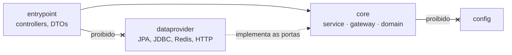
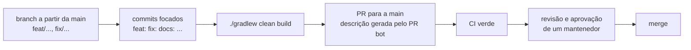

# Contribuindo com a ds-mobile-api

Ao participar, você concorda em seguir o [Código de Conduta](CODE_OF_CONDUCT.md). Para reportar um problema de segurança, **não** abra uma issue — siga o [SECURITY.md](SECURITY.md).

## Idioma

Código de domínio, mensagens de erro, commits, issues e PRs são escritos em português do Brasil, como no restante do projeto.

## Configurando o ambiente

1. Instale o JDK 21 e o Docker.
2. Faça o fork ou clone o repositório:
   ```bash
   git clone https://github.com/EcoCiente-Instituto-J-F/ds-mobile-api.git
   cd ds-mobile-api
   ```
3. Copie `.env.example` para `.env` (`Copy-Item .env.example .env` no PowerShell) e preencha as variáveis listadas no [README](README.md#instalando). O `.env` está no `.gitignore`; nunca o commite.
4. Se não tiver o modelo CLIP, use `VALIDADOR_ATIVO=false`. Para não rodar os jobs agendados, use `APP_JOBS_ENABLED=false`.
5. Rode a aplicação com `./gradlew bootRun` (ou `gradlew.bat bootRun` no Windows).

## Testando sua mudança

O CI executa:

```bash
./gradlew clean build --no-daemon
```

Rode o mesmo comando antes de abrir a PR. Parte dos testes de integração usa Testcontainers (PostgreSQL 16), então o Docker precisa estar ativo.

Se a mudança tocar educação, pontuação, senha, ranking ou perfil, rode também os testes marcados com `@Tag("integracao")`/`@Tag("banco")`, que o CI **não** executa:

```bash
./gradlew integrationTest
```

Mudanças no validador de fotos que dependam do modelo real usam a tag `modelo` e rodam com `./gradlew testeModelo` (exige `CLIP_DIR`).

- Toda mudança de comportamento vem com um teste que falha sem ela.
- Os testes não usam rede externa, APIs pagas nem dados de produção.
- Dados de teste ficam em `src/test/resources/sql`, sempre fictícios.

## Regras do projeto

### Arquitetura

O projeto segue arquitetura hexagonal, e as regras são verificadas pelo ArchUnit (`src/test/java/br/com/ecociente/mobile/architecture/ArquiteturaTest.java`). Uma violação quebra o build.



- `core` não depende de `entrypoint`, `dataprovider` nem `config`, e não importa Spring Data, JDBC, DAO, Spring Security, Spring Web/HTTP, JPA, Hibernate, driver do PostgreSQL, Firebase ou ONNX Runtime.
- `core.domain` não usa Spring, JPA nem Jackson, e não depende de `core.service` nem de `core.gateway`.
- `core.gateway` não depende de `core.service`.
- `entrypoint` e `dataprovider` não se conhecem.
- Não existe pacote `usecase`: casos de uso ficam em `core.service`.
- Código novo entra na subpasta da sua área (`autenticacao`, `cadastro`, `calendario`, `educacao`, `pontuacao`, `senha`, `validador`), como o restante do projeto.

### Segurança e dados

- **Rotas protegidas por padrão:** a lista de rotas públicas fica em `config/security/SecurityConfig.java`. Qualquer rota nova sem autenticação precisa ser discutida na PR.
- **Identidade vem do token:** o `usuarioId` é lido do JWT (`Authentication`/`@AuthenticationPrincipal`). Quando o corpo da requisição também traz `usuarioId` (rotas do validador), ele é conferido com o do token por `entrypoint/security/ValidadorUsuario.java`.
- **Perfil na rota, dono no service:** restrição por perfil usa `@PreAuthorize` (método habilitado em `PontuacaoSchedulingConfig`), com as regras compartilhadas em `config/pontuacao/AutorizacaoPontuacao.java`. A verificação de dono (síndico responsável, responsável ativo pela cooperativa, vínculo aprovado no condomínio, participante da conversa) fica no service do `core`, que lança a exceção de negócio traduzida em 403/404 pelos handlers de `entrypoint/exception`.
- **Download de fotos só de hosts permitidos:** não relaxe as travas de `dataprovider/validador/foto/FotoHttpGateway.java` (lista de hosts, sem redirecionamento, limite de tamanho e timeout).
- **Logs sem dados pessoais:** o log de vereditos da triagem não grava a URL da foto, que pode conter token de URL assinada. Mantenha esse cuidado em logs novos.
- Nenhum segredo, token ou senha no repositório.
- Nenhum dado pessoal real em testes, exemplos ou no Swagger.

### Configuração e banco

- **Configuração em um só lugar:** variáveis novas entram em `src/main/resources/application.properties` (com padrão, quando fizer sentido), com a documentação correspondente no README e no `.env.example`.
- **Banco:** o schema é gerenciado fora deste repositório (`ddl-auto=validate`); não crie tabelas por aqui.
- **Dependências:** nenhuma dependência nova no `build.gradle` sem discussão prévia.
- **Versão:** a versão em `build.gradle` (`MAJOR.MINOR.PATCH`) define a tag da imagem Docker publicada na `main`, e tags são imutáveis. Mude a versão só quando for publicar.

## Pull requests



1. Crie a branch a partir da `main` (por exemplo `feat/nome-curto`, `fix/nome-curto` ou `docs/nome-curto`).
2. Faça commits focados, com prefixos `feat:`, `fix:`, `chore:`, `docs:`, `test:` ou `refactor:`. Um escopo opcional é bem-vindo, como em `fix(mobile): ...`.
3. Abra a PR para a `main`. A descrição é gerada pelo PR bot (`.github/workflows/pr-bot.yml`) para branches do próprio repositório; revise-a e complete os checklists. Em PRs vindas de fork, escreva a descrição você mesmo.
4. O CI precisa passar.
5. Um mantenedor revisa e aprova antes do merge.

## Reportando bugs e propondo funcionalidades

Abra uma issue descrevendo o comportamento esperado e o observado, com passos para reproduzir (usando dados fictícios) e a versão ou commit afetado. Para novas funcionalidades, explique o problema que ela resolve antes de propor a implementação.
