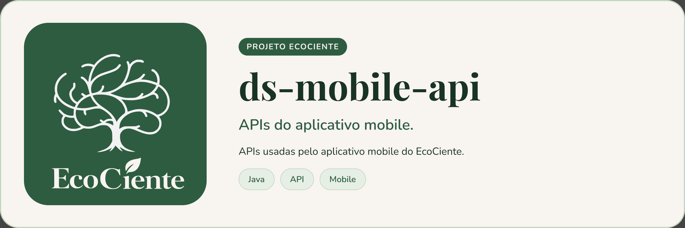

<p align="center">
  
</p>

# ds-mobile-api


> API do aplicativo mobile do EcoCiente: cursos, aulas e quizzes de educação ambiental, postagens de descarte de resíduos, cooperativas, avaliação de coletas e dashboard do síndico.

## Sobre o projeto

A `ds-mobile-api` é o back-end consumido pelo app mobile do EcoCiente. Ela lê e grava em um banco PostgreSQL compartilhado e autentica as requisições com JWT (o token é emitido pela `ds-autenticacao-api`; esta API apenas valida a assinatura).

Funcionalidades atuais:

| Área | Endpoints | Quem acessa |
| --- | --- | --- |
| Perfil | `GET /api/usuarios/me` | Usuário autenticado |
| Cursos | `GET /api/cursos`, `GET /api/cursos/{cursoId}` | Usuário autenticado |
| Aulas | `GET /api/cursos/{cursoId}/aulas`, `GET /api/aulas/{aulaId}` | Usuário autenticado |
| Quizzes | `GET /api/aulas/{aulaId}/quiz`, `POST /api/quizzes/{id}/tentativas`, `POST /api/tentativas-quiz/{id}/finalizar`, `GET /api/tentativas-quiz/{id}/revisao` | Usuário autenticado |
| Postagens de descarte | `POST /api/postagens`, `GET /api/postagens` | Morador com vínculo aprovado no condomínio |
| Minhas postagens | `GET /api/postagens/minhas` | Usuário autenticado (só as próprias) |
| Categorias de resíduo | `GET /api/categorias-residuos` | Usuário autenticado |
| Cooperativas próximas | `GET /api/cooperativas?page=0&size=10` | Síndico de condomínio ativo |
| Avaliações da cooperativa | `GET /api/cooperativas/{id}/avaliacoes` | Responsável ativo pela cooperativa |
| Condomínios atendidos | `GET /api/cooperativas/{id}/condominios?page=0&size=10` | Responsável ativo pela cooperativa |
| Avaliação de coleta | `POST /api/agendamentos/{id}/avaliacao` | Síndico do condomínio do agendamento |
| Dashboard do síndico | `GET /api/condominios/{id}/dashboard` | Síndico responsável pelo condomínio |

- **Cooperativas próximas:** lista as cooperativas da mesma cidade e estado dos condomínios do síndico. O banco não guarda coordenadas, então não há cálculo de distância.
- **Avaliação de coleta:** só vale para coleta realizada e aceita uma avaliação por visita. A nota entra na média da cooperativa.
- **Dashboard do síndico:** lido da view `vw_dashboard_sindico`.
- **Condomínios atendidos:** o critério de "atendido" e o formato da resposta estão em [docs/condominios-atendidos.md](docs/condominios-atendidos.md).
- Nas rotas paginadas, `page` começa em zero e `size` vai de 1 a 100; valores fora disso retornam 400.

Ao finalizar um quiz, a API chama a `ds-pontuacao-api` para consolidar a pontuação. Se a integração não estiver configurada, o resultado fica como pendente.

A documentação interativa (Swagger UI) fica em `/swagger-ui/index.html` e o JSON OpenAPI em `/api-docs`. Para testar as rotas pelo Swagger, faça login na `ds-autenticacao-api`, clique em **Authorize** e cole o token.

## Pré-requisitos

- JDK 21 (o `build.gradle` exige essa versão via toolchain)
- PostgreSQL com o schema do EcoCiente já criado (a aplicação usa `ddl-auto=validate` e não cria tabelas)
- Docker, para rodar os testes de integração (Testcontainers) e para a imagem da aplicação

## Instalando

```bash
git clone https://github.com/EcoCiente-Instituto-J-F/ds-mobile-api.git
cd ds-mobile-api
cp .env.example .env
```

No Windows (PowerShell), use `Copy-Item .env.example .env`.

Edite o `.env`. A aplicação lê esse arquivo na raiz (`spring.config.import`) e também aceita variáveis de ambiente:

| Variável | Obrigatória | Descrição |
| --- | --- | --- |
| `DB_URL` | sim | URL JDBC do PostgreSQL, por exemplo `jdbc:postgresql://localhost:5432/ecociente` |
| `DB_USERNAME` | sim | Usuário do banco |
| `DB_PASSWORD` | sim | Senha do banco |
| `JWT_SECRET` | sim | Segredo HMAC usado para validar os JWT |
| `PONTUACAO_BASE_URL` | não | URL da `ds-pontuacao-api`, sem o caminho dos endpoints |
| `PONTUACAO_TOKEN_SERVICO` | não | JWT de serviço aceito pela pontuação (perfil `SERVICE` ou `ADMIN`), sem o prefixo `Bearer`. Não é o `JWT_SECRET` |
| `APP_PORT` | não | Porta publicada pelo Docker Compose (padrão `8080`) |
| `SERVER_PORT` | não | Porta interna da aplicação (padrão `9654`; a imagem Docker define `8080`) |

## Usando

Localmente:

```bash
./gradlew bootRun
```

No Windows, use `gradlew.bat bootRun`. Sem `SERVER_PORT`, a API sobe em `http://localhost:9654`.

Com Docker Compose:

```bash
docker compose up --build
```

A API fica em `http://localhost:8080` (ou na porta de `APP_PORT`). Todas as rotas exigem `Authorization: Bearer <jwt>`, exceto o Swagger e o `/api-docs`. O JWT precisa ter `sub` (e-mail), `usuarioId`, `exp` e, opcionalmente, `perfil`.

## Testes

```bash
./gradlew clean build --no-daemon
```

É o mesmo comando do CI. Os testes de integração sobem um PostgreSQL com Testcontainers, então o Docker precisa estar rodando. Os schemas e dados de teste ficam em `src/test/resources/sql`.

## Estrutura do projeto

```
.
├── src/main/java/br/com/ecociente/mobile
│   ├── config
│   │   ├── security        # filtro JWT e SecurityConfig
│   │   └── swagger         # OpenAPI e botão Authorize (Bearer JWT)
│   ├── core
│   │   ├── domain          # modelos e registros de domínio
│   │   ├── exception       # exceções de negócio
│   │   ├── gateway         # interfaces de acesso a dados e integrações
│   │   └── service         # casos de uso
│   ├── dataprovider
│   │   ├── entity          # entidades JPA
│   │   ├── gateway         # implementações dos gateways (JPA, SQL, REST)
│   │   ├── mapper
│   │   └── repository
│   └── entrypoint
│       ├── controller      # endpoints REST
│       ├── dto             # request/response
│       ├── exception       # handlers de erro
│       └── mapper
├── src/main/resources      # application.properties
├── src/test                # testes de domínio, serviço e integração (+ SQL de teste)
├── docs                    # regras detalhadas de endpoints
├── assets                  # imagens do README
├── scripts/pr-bot          # gerador de descrição de PR (Python)
├── .github/workflows       # CI (build, imagem Docker) e PR bot
├── Dockerfile
├── docker-compose.yml
└── build.gradle
```

## Contribuindo

Leia o [CONTRIBUTING.md](CONTRIBUTING.md) antes de abrir uma PR. Ao participar, você concorda com o [Código de Conduta](CODE_OF_CONDUCT.md).

## Segurança

Encontrou uma vulnerabilidade? Siga o [SECURITY.md](SECURITY.md). **Não abra issue pública.**

## Licença

Este projeto está sob a licença MIT. Veja o arquivo [LICENSE](LICENSE).
