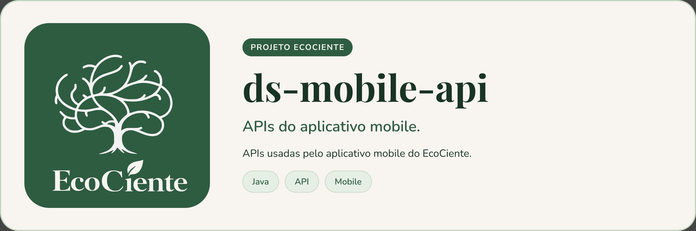
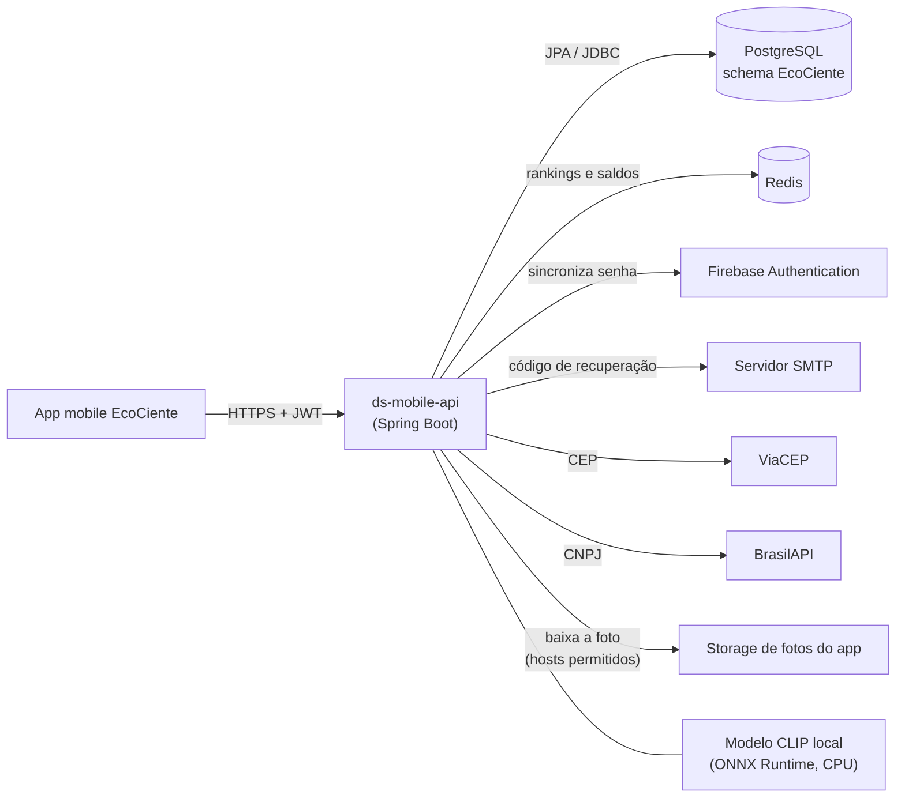
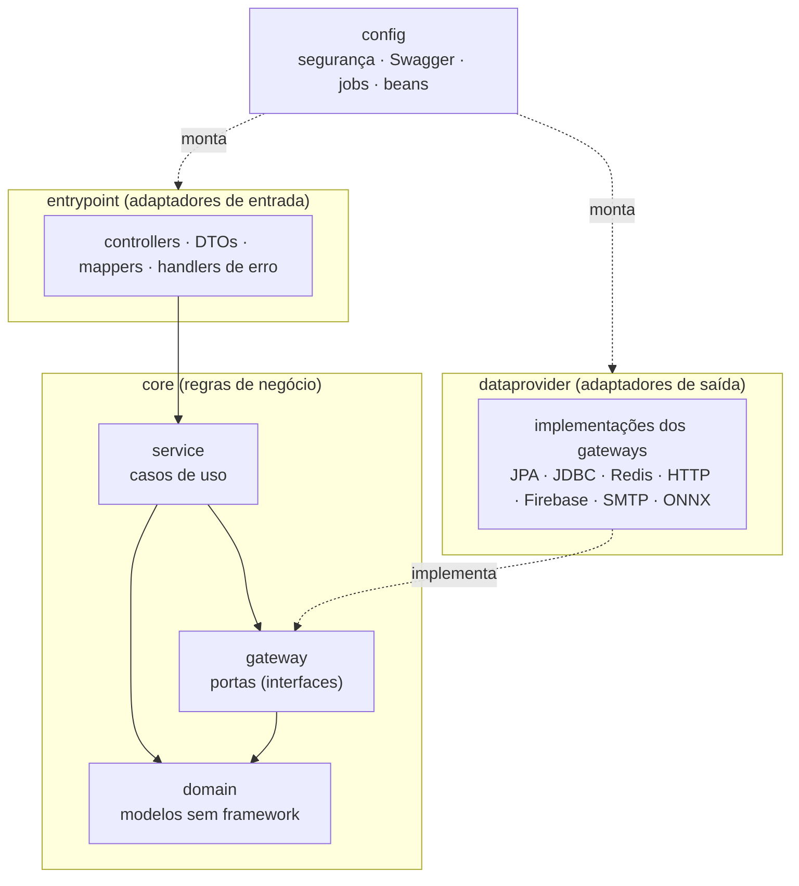
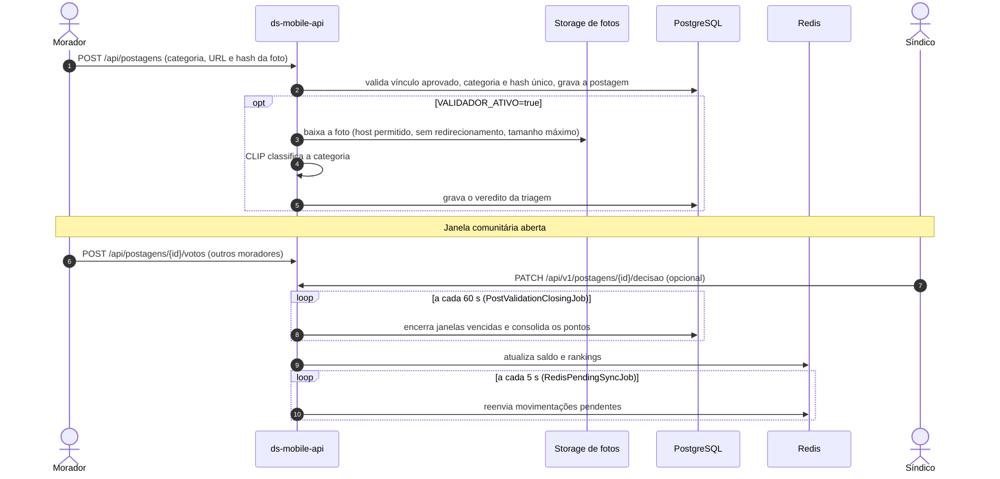
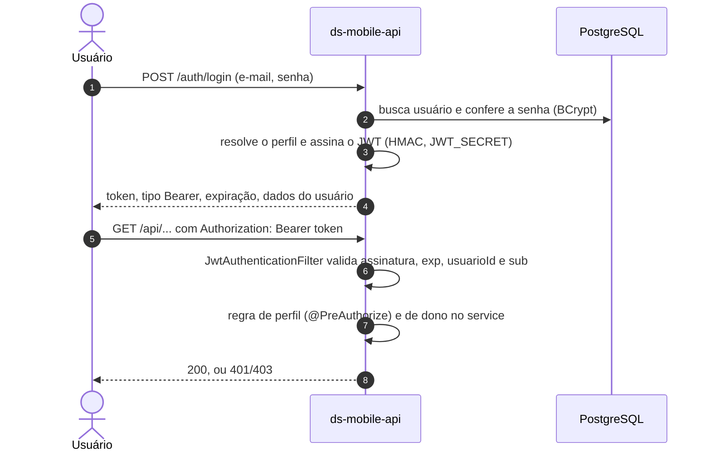
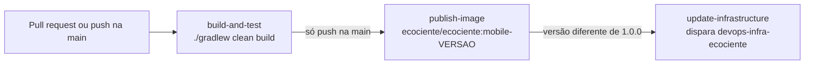

<p align="center">
  
</p>

# ds-mobile-api


> API unificada do aplicativo mobile do EcoCiente: autenticação, cadastro, recuperação de senha, educação ambiental (cursos, aulas e quizzes), calendário de coletas, chat, descartes com validação de fotos, pontuação e rankings.

## Sumário

- [Sobre o projeto](#sobre-o-projeto)
- [Arquitetura](#arquitetura)
- [Funcionalidades e endpoints](#funcionalidades-e-endpoints)
- [Pré-requisitos](#pré-requisitos)
- [Instalando](#instalando)
- [Usando](#usando)
- [Testes](#testes)
- [Estrutura do projeto](#estrutura-do-projeto)
- [Contribuindo](#contribuindo)
- [Segurança](#segurança)
- [Licença](#licença)

## Sobre o projeto

A `ds-mobile-api` é o back-end consumido pelo app mobile do EcoCiente. Ela concentra em um só serviço Spring Boot o que antes estava em APIs separadas (autenticação, cadastro, senha, calendário, pontuação e validador de postagens).

- **Autenticação própria:** `POST /auth/login` confere e-mail e senha (BCrypt) e emite um JWT HMAC com `sub` (e-mail), `usuarioId`, `nome` e `perfil`. As demais rotas exigem `Authorization: Bearer <jwt>`.
- **Perfis:** `USUARIO_COMUM`, `MORADOR`, `SINDICO`, `COOPERATIVA` e `ADMIN`. Integrações internas usam um token com perfil `SERVICE`.
- **Banco:** PostgreSQL compartilhado do EcoCiente. A aplicação usa `ddl-auto=validate` e não cria tabelas.
- **Ranking:** saldos e rankings ficam no PostgreSQL e são espelhados no Redis. Um job reenvia ao Redis as movimentações que ficaram pendentes.
- **Validação de fotos:** a foto do descarte é baixada do storage do app (só de hosts permitidos) e classificada localmente com CLIP (ViT-B/32) em ONNX Runtime, sem chamar serviços externos. A triagem pode ser desligada com `VALIDADOR_ATIVO=false`.
- **Senha:** a recuperação envia um código de 4 dígitos por e-mail (SMTP), válido por 15 minutos. Depois de 5 códigos errados para o mesmo e-mail, `POST /senhas/redefinir` fica bloqueado até o fim da janela de 15 minutos (contador no Redis). Toda troca de senha também é sincronizada no Firebase Authentication.

A documentação interativa (Swagger UI) fica em `/swagger-ui.html` e o JSON OpenAPI em `/api-docs`. Para testar pelo Swagger, chame `POST /auth/login`, clique em **Authorize** e cole só o token, sem o prefixo `Bearer`.

## Arquitetura

### Visão geral



### Camadas (arquitetura hexagonal)

O código segue portas e adaptadores. As regras abaixo são verificadas pelo ArchUnit em `src/test/java/br/com/ecociente/mobile/architecture/ArquiteturaTest.java` e quebram o build se forem violadas.



- `core` não depende de `entrypoint`, `dataprovider` nem `config`, e não importa Spring Data, JDBC, Spring Security, Spring Web, JPA, Hibernate, driver do PostgreSQL, Firebase ou ONNX Runtime.
- `core.domain` não usa Spring, JPA nem Jackson, e não depende de `service` nem de `gateway`.
- `entrypoint` não acessa `dataprovider`, e `dataprovider` não acessa `entrypoint`.

### Ciclo de vida de um descarte



### Login e uso do token



## Funcionalidades e endpoints

Rotas públicas: `POST /auth/login`, `POST /api/cadastro/{comum|morador|cooperativa}`, `POST /senhas/esqueceu`, `POST /senhas/redefinir` e o Swagger. Todas as outras exigem JWT.

| Área | Endpoints | Quem acessa |
| --- | --- | --- |
| Autenticação | `POST /auth/login` | Público |
| Cadastro | `POST /api/cadastro/comum`, `POST /api/cadastro/morador`, `POST /api/cadastro/cooperativa` | Público (CEP via ViaCEP, CNPJ via BrasilAPI) |
| Perfil | `GET /api/usuarios/me`, `PATCH /api/usuarios/me`, `PATCH /api/usuarios/me/endereco`, `DELETE /api/usuarios/me` | Usuário autenticado (só a própria conta) |
| Condomínios | `PATCH /api/condominios/{id}`, `PATCH /api/condominios/{id}/endereco`, `GET /api/condominios/{id}/dashboard` | Síndico responsável pelo condomínio |
| Senha | `POST /senhas/esqueceu`, `POST /senhas/redefinir`, `POST /senhas/alterar` | Público (`esqueceu`, `redefinir`); autenticado (`alterar`) |
| Cursos e aulas | `GET /api/cursos`, `GET /api/cursos/{cursoId}`, `GET /api/cursos/{cursoId}/aulas`, `GET /api/aulas/{aulaId}` | Usuário autenticado |
| Quizzes | `GET /api/aulas/{aulaId}/quiz`, `POST /api/quizzes/{id}/tentativas`, `POST /api/tentativas-quiz/{id}/finalizar`, `GET /api/tentativas-quiz/{id}/revisao` | Usuário comum e morador (síndico, cooperativa e admin ficam de fora) |
| Histórico de quizzes | `GET /api/tentativas-quiz?limite=20`, `GET /api/tentativas-quiz/quizzes-concluidos` | Usuário autenticado (só as próprias tentativas) |
| Calendário | `GET /api/v1/agendamentos`, `GET /api/v1/agendamentos/proxima`, `POST /api/v1/agendamentos`, `PATCH /api/v1/agendamentos/{id}/status` | Morador, síndico ou cooperativa (a consulta muda conforme o perfil) |
| Avaliação de coleta | `POST /api/agendamentos/{id}/avaliacao` | Síndico do condomínio do agendamento |
| Cooperativas | `GET /api/cooperativas?page=0&size=10`, `GET /api/cooperativas/{id}` | Síndico de condomínio ativo |
| Avaliações e condomínios atendidos | `GET /api/cooperativas/{id}/avaliacoes`, `GET /api/cooperativas/{id}/condominios` | Responsável ativo pela cooperativa |
| Chat | `POST /api/conversas`, `GET /api/conversas`, `POST /api/conversas/{id}/mensagens`, `GET /api/conversas/{id}/mensagens`, `PATCH /api/conversas/{id}/leitura`, `PATCH /api/conversas/{id}/arquivamento` | Participantes da conversa (lado condomínio ou cooperativa) |
| Descartes | `POST /api/postagens`, `GET /api/postagens`, `POST /api/postagens/{id}/votos`, `GET /api/postagens/minhas`, `GET /api/categorias-residuos` | Morador com vínculo aprovado no condomínio (`minhas` e categorias: autenticado) |
| Postagens em análise | `GET /api/condominios/{id}/postagens/em-analise` | Síndico responsável pelo condomínio |
| Validação | `PATCH /api/v1/postagens/{id}/decisao`, `POST /api/v1/postagens/{id}/finalizar-validacao` | `ADMIN` ou `SINDICO` (decisão); `ADMIN` (finalizar) |
| Validador de fotos | `POST /v1/postagens/{id}/triagem`, `POST /v1/postagens/{id}/votos`, `POST /v1/postagens/{id}/decisao` | `ADMIN` ou `SERVICE` (triagem); usuário do token igual ao `usuarioId` do corpo (votos e decisão) |
| Pontuação | `GET /api/v1/pontuacoes/usuarios/{usuarioId}/saldo`, `GET /api/v1/pontuacoes/usuarios/{usuarioId}/movimentacoes` | O próprio usuário ou `ADMIN` |
| Consolidação de pontos | `POST /api/v1/pontuacoes/postagens/{id}/consolidar`, `POST /api/v1/pontuacoes/quizzes/tentativas/{id}/consolidar`, `POST /api/v1/pontuacoes/postagens/{id}/reconciliar` | `ADMIN` ou `SERVICE` |
| Rankings | `GET /api/v1/rankings/moradores`, `GET /api/v1/rankings/torres`, `GET /api/v1/rankings/moradores/{usuarioId}/posicao`, `GET /api/v1/rankings/torres/{torreId}/posicao` (todos com `condominioId`) | Síndico ou usuário com vínculo ativo no condomínio |
| Administração | `POST /api/v1/admin/rankings/reconstruir`, `POST /api/v1/admin/redis/sincronizar-pendentes`, `GET /api/v1/admin/redis/status` | `ADMIN` (sincronizar: também `SERVICE`) |

Detalhes de algumas regras:

- **Histórico de quizzes:** `GET /api/tentativas-quiz` devolve as tentativas concluídas do usuário, da mais recente para a mais antiga, com `tentativaId`, `quizId`, `titulo`, `nota` (0 a 100), `aprovado` e `concluidoEm`. `limite` é opcional (padrão 20, de 1 a 50; fora disso, 400 `LIMITE_INVALIDO`). Tentativas em andamento não entram, e as reprovadas entram.
- **Quizzes concluídos:** `GET /api/tentativas-quiz/quizzes-concluidos` devolve os ids distintos dos quizzes já concluídos (aprovados ou não), por exemplo `[12, 18, 25]`.
- **Pontos do quiz:** ao finalizar uma tentativa, os pontos são consolidados nesta mesma API. Se o banco falhar, o resultado volta como pendente; se o Redis falhar, os pontos ficam gravados e o job sincroniza depois.
- **Cooperativas próximas:** lista as cooperativas da mesma cidade e estado dos condomínios do síndico. O banco não guarda coordenadas, então não há cálculo de distância.
- **Avaliação de coleta:** só vale para coleta realizada, com uma avaliação por visita. A nota entra na média da cooperativa.
- **Dashboard do síndico:** lido da view `vw_dashboard_sindico`.
- **Condomínios atendidos:** o critério de "atendido" e o formato da resposta estão em [docs/condominios-atendidos.md](docs/condominios-atendidos.md).
- **Paginação:** começa em zero. Nas rotas com `page`/`size`, `size` vai de 1 a 100; nos rankings, `limit` vai de 1 a 100.
- **Chat:** mensagens têm de 1 a 2000 caracteres. Para enviar mensagem numa conversa arquivada, é preciso desarquivá-la antes (senão, 409 `CONVERSA_ARQUIVADA`).

## Pré-requisitos

- JDK 21 (o `build.gradle` exige essa versão via toolchain).
- PostgreSQL com o schema do EcoCiente já criado (a aplicação usa `ddl-auto=validate`).
- Redis, para saldos e rankings.
- Conta de serviço do Firebase (JSON), para sincronizar as senhas.
- Servidor SMTP, para enviar o código de recuperação de senha.
- Com o validador ligado (padrão): a pasta do CLIP ViT-B/32 exportado do Hugging Face para ONNX, com `vision_model.onnx`, `text_model.onnx` e `tokenizer.json`.
- Docker, para os testes com Testcontainers e para gerar a imagem.

## Instalando

```bash
git clone https://github.com/EcoCiente-Instituto-J-F/ds-mobile-api.git
cd ds-mobile-api
cp .env.example .env
```

No Windows (PowerShell), use `Copy-Item .env.example .env`.

Edite o `.env`. A aplicação lê esse arquivo na raiz (`spring.config.import=optional:file:.env[.properties]`) e também aceita variáveis de ambiente. Os nomes e padrões abaixo vêm de `src/main/resources/application.properties`.

| Variável | Obrigatória | Padrão | Descrição |
| --- | --- | --- | --- |
| `DB_URL` | sim | | URL JDBC do PostgreSQL, por exemplo `jdbc:postgresql://localhost:5432/ecociente` |
| `DB_USERNAME` | sim | | Usuário do banco |
| `DB_PASSWORD` | sim | | Senha do banco |
| `JWT_SECRET` | sim | | Segredo HMAC usado para assinar e validar os JWT (no mínimo 32 bytes) |
| `JWT_EXPIRATION_MS` | não | `300000` | Validade do token em milissegundos |
| `CORS_ORIGINS` | não | `http://localhost:5173` | Origens permitidas, separadas por vírgula |
| `FIREBASE_CREDENCIAIS` | sim | | Conteúdo JSON da conta de serviço do Firebase (o texto, não o caminho do arquivo) |
| `MAIL_HOST` | sim | | Host SMTP (STARTTLS obrigatório) |
| `MAIL_PORT` | não | `587` | Porta SMTP |
| `MAIL_USERNAME` | sim | | Usuário SMTP |
| `MAIL_PASSWORD` | sim | | Senha SMTP |
| `MAIL_FROM` | sim | | Remetente dos e-mails de recuperação |
| `REDIS_HOST` | sim | | Host do Redis |
| `REDIS_PORT` | não | `6379` | Porta do Redis |
| `REDIS_USERNAME` | não | vazio | Usuário do Redis |
| `REDIS_PASSWORD` | não | vazio | Senha do Redis |
| `RANKING_CYCLE_EPOCH` | sim | | Data inicial dos ciclos de ranking (`yyyy-MM-dd`); moradores fecham a cada 7 dias e torres a cada 30 |
| `VALIDADOR_ATIVO` | não | `true` | `false` desliga a triagem automática de fotos (as postagens seguem direto para a votação) |
| `HOSTS_PERMITIDOS` | com validador | | Hosts de onde a foto pode ser baixada, separados por vírgula |
| `CLIP_DIR` | com validador | | Pasta com os arquivos ONNX e o `tokenizer.json` do CLIP |
| `LIMIAR_CONFIANCA` | não | `0.5` | Confiança mínima (0 a 1) para aceitar a categoria |
| `LIMIAR_REVISAO` | não | vazio | Início da zona de revisão humana (0 a 1): confiança entre este valor e o limiar da categoria não aprova nem recusa. Vazio = sem zona de revisão |
| `LIMIARES_POR_CATEGORIA` | não | vazio | JSON com limiar por categoria, por exemplo `{"vidro": 0.6}` |
| `MAX_PEDIDOS_SIMULTANEOS` | não | `8` | Triagens em paralelo; acima disso, o pedido é recusado |
| `TAMANHO_MAXIMO_BYTES` | não | `10000000` | Tamanho máximo da foto baixada |
| `TIMEOUT_DOWNLOAD_SEGUNDOS` | não | `10` | Timeout do download da foto |
| `APP_JOBS_ENABLED` | não | `true` | `false` desliga os jobs de fechamento de validação e de sincronização do Redis |
| `SERVER_PORT` | não | `9654` | Porta HTTP (a imagem Docker define `8080`) |
| `APP_PORT` | não | `8080` | Porta publicada pelo `docker-compose.yml` |

O `.env` é lido como arquivo `.properties`: um valor por linha e sem aspas (o JSON do Firebase também vai em uma linha).

## Usando

Localmente:

```bash
./gradlew bootRun
```

No Windows, use `gradlew.bat bootRun`. Sem `SERVER_PORT`, a API sobe em `http://localhost:9654`, com o Swagger em `http://localhost:9654/swagger-ui.html`.

Para subir sem o modelo CLIP, defina `VALIDADOR_ATIVO=false`. Para não rodar os jobs agendados (por exemplo, em um preflight), defina `APP_JOBS_ENABLED=false`.

Com Docker Compose:

```bash
docker compose up --build
```

A API fica em `http://localhost:8080` (ou na porta de `APP_PORT`). A imagem roda com usuário sem privilégios. O `.env` não entra na imagem (está no `.dockerignore`): o compose o repassa ao container com `env_file`. Dentro do container, `localhost` é o próprio container, então use `host.docker.internal` em `DB_URL` e `REDIS_HOST` para alcançar serviços da sua máquina. Com o validador ligado, descomente o volume do CLIP no `docker-compose.yml` e use `CLIP_DIR=/modelos/clip`.

Sem o compose, o equivalente é `docker build -t ds-mobile-api .` seguido de `docker run --env-file .env -p 8080:8080 ds-mobile-api`.

Exemplo de chamada:

```bash
TOKEN=$(curl -s -X POST http://localhost:9654/auth/login \
  -H "Content-Type: application/json" \
  -d '{"email":"usuario@exemplo.com","senha":"SenhaFicticia@1"}' | jq -r .token)

curl -H "Authorization: Bearer $TOKEN" http://localhost:9654/api/usuarios/me
```

## Testes

```bash
./gradlew clean build --no-daemon
```

É o comando do CI (`.github/workflows/ci.yml`). Ele roda os testes de unidade, as regras do ArchUnit e os testes de integração sem tag, que sobem um PostgreSQL 16 com Testcontainers. O Docker precisa estar rodando.

Outras tarefas do `build.gradle`:

| Tarefa | O que roda |
| --- | --- |
| `./gradlew test` | Testes sem as tags `integracao`, `banco` e `modelo` |
| `./gradlew integrationTest` | Testes com as tags `integracao` e `banco` (educação, pontuação, senha, ranking no Redis, perfil). O CI não roda esta tarefa |
| `./gradlew testesMigracao` | `test` seguido de `integrationTest` |
| `./gradlew testeModelo` | Testes com o modelo CLIP real (tag `modelo`); exige `CLIP_DIR` |
| `./gradlew calibrar -PpastaAmostras=amostras` | Não é teste: mede os acertos do CLIP por limiar com fotos reais em `amostras/<categoria>/` e `amostras/nao_residuo/`, para escolher o `LIMIAR_CONFIANCA`; exige `CLIP_DIR` |

Os schemas e dados de teste ficam em `src/test/resources/sql`.



A tag da imagem vem do `version` do `build.gradle`. Tags publicadas são imutáveis: o CI falha se a versão já existir no Docker Hub.

## Estrutura do projeto

```
.
├── src/main/java/br/com/ecociente/mobile
│   ├── MobileApplication.java
│   ├── calibracao/validador    # calibração do limiar do CLIP (./gradlew calibrar, uso offline)
│   ├── config
│   │   ├── security            # SecurityConfig, filtro JWT, emissão e validação do token
│   │   ├── pontuacao           # autorização da pontuação e jobs agendados
│   │   ├── validador           # propriedades do validador e carga do CLIP
│   │   ├── firebase            # cliente do Firebase Authentication
│   │   └── swagger             # OpenAPI e botão Authorize
│   ├── core
│   │   ├── domain              # modelos de domínio, por área
│   │   ├── exception           # exceções de negócio
│   │   ├── gateway             # portas (interfaces) de dados e integrações
│   │   ├── imagem/validador    # hash perceptual (dHash), luminância e reamostragem da foto
│   │   └── service             # casos de uso
│   ├── dataprovider
│   │   ├── client, dto         # BrasilAPI e ViaCEP
│   │   ├── entity, repository  # JPA
│   │   ├── gateway             # implementações das portas (JPA, JDBC, Redis, Firebase, SMTP)
│   │   ├── mapper
│   │   └── validador           # download da foto, CLIP em ONNX, gateway JDBC da validação
│   └── entrypoint
│       ├── controller          # endpoints REST, por área
│       ├── dto                 # requests e responses
│       ├── exception           # handlers de erro
│       ├── mapper
│       ├── metricas/validador  # métricas Micrometer da triagem
│       └── security            # conferência do usuário nas rotas do validador
├── src/main/resources          # application.properties
├── src/test                    # unidade, arquitetura (ArchUnit) e integração (+ SQL de teste)
├── docs                        # regras detalhadas de endpoints
├── assets                      # imagens do README
├── scripts/pr-bot              # gerador de descrição de PR (Python)
├── .github/workflows           # CI (build, imagem, infraestrutura) e PR bot
├── Dockerfile
├── docker-compose.yml
└── build.gradle
```

## Contribuindo

Leia o [CONTRIBUTING.md](CONTRIBUTING.md) antes de abrir uma PR. Ao participar, você concorda com o [Código de Conduta](CODE_OF_CONDUCT.md).

## Segurança

Encontrou uma vulnerabilidade? Siga o [SECURITY.md](SECURITY.md). **Não abra issue pública.**

## Licença

Este projeto está sob a licença MIT. Veja o arquivo [LICENSE](LICENSE).
