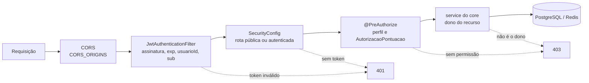

# Política de Segurança

A `ds-mobile-api` autentica os usuários do app mobile do EcoCiente e trata dados pessoais de moradores, síndicos e cooperativas: nome, e-mail, CPF, data de nascimento, endereço, telefones, CNPJ e vínculo com condomínios. Também guarda hashes de senha e de códigos de recuperação, os tokens emitidos, mensagens do chat entre condomínio e cooperativa, postagens de descarte (com URL e hash da foto), avaliações de coletas e a pontuação dos usuários. Levamos a proteção desses dados a sério.

## Versões suportadas

| Versão | Suporte |
| --- | --- |
| `main` (mais recente) | Sim |
| Demais branches e imagens de versões anteriores | Não |

## Reportando uma vulnerabilidade

**Não abra issue, PR ou discussão pública** para falhas de segurança.

Use o relato privado do GitHub: [abrir um advisory](https://github.com/EcoCiente-Instituto-J-F/ds-mobile-api/security/advisories/new) (aba **Security → Advisories → Report a vulnerability**).

> Mantenedores: ative o *Private vulnerability reporting* em **Settings → Code security** para que esse formulário fique disponível.

Inclua no relato:

- o impacto (quais dados ou ações ficam expostos);
- passos para reproduzir, usando **dados fictícios**;
- o commit testado e a configuração usada;
- se tiver, uma ideia de correção.

O que acontece depois:

1. Confirmamos o recebimento do relato.
2. Investigamos e desenvolvemos a correção em privado.
3. Publicamos o advisory com a correção, dando crédito a quem reportou (se desejar).

Pedimos um prazo razoável para corrigir antes de qualquer divulgação pública.

## Escopo

**Dentro do escopo:**

- acesso a dados de outro usuário, condomínio, cooperativa ou conversa;
- burla de autenticação ou autorização (JWT forjado ou reaproveitado, elevação de perfil, rotas de `ADMIN`/`SERVICE` acessíveis a outros perfis, vínculo com condomínio, síndico responsável, responsável ativo pela cooperativa);
- burla do fluxo de recuperação ou troca de senha (inclusive contornar o limite de tentativas do código), ou divergência entre a senha do banco e a do Firebase que permita acesso;
- forjar ou inflar pontuação, votos, decisões de validação ou posição no ranking;
- avaliar coleta de outro condomínio, avaliar mais de uma vez a mesma visita ou avaliar coleta não realizada;
- SSRF pelo download de fotos do validador (acesso a host fora de `HOSTS_PERMITIDOS`, redirecionamento, leitura de rede interna);
- injeção (SQL, comandos) com exposição ou alteração de dados;
- vazamento de dados pessoais, tokens ou segredos em logs ou respostas;
- segredos commitados no repositório.

**Fora do escopo:**

- bugs sem impacto de segurança;
- falhas em serviços de terceiros (Firebase, ViaCEP, BrasilAPI, provedor SMTP) ou em outros repositórios do EcoCiente (reporte no repositório correspondente);
- valores de exemplo do `.env.example` e dos testes;
- erros de classificação do modelo CLIP sem impacto de segurança;
- negação de serviço contra a infraestrutura de deploy.

## Como o sistema protege os dados

Toda requisição passa pelas camadas abaixo antes de chegar aos dados:

| Camada | Onde | O que faz |
| --- | --- | --- |
| Login | `core/service/autenticacao/AuthService.java`, `config/security/SecurityConfig.java` | Confere a senha com BCrypt e emite JWT HMAC com validade curta (`JWT_EXPIRATION_MS`, padrão 5 minutos) |
| Autenticação | `config/security/JwtAuthenticationFilter.java`, `JwtService.java` | Valida a assinatura, exige `exp` futuro, `usuarioId` positivo e `sub`; token inválido recebe 401 |
| Rotas | `config/security/SecurityConfig.java` | Sessão stateless, CSRF/form login/basic desligados; só login, cadastro, `senhas/esqueceu`, `senhas/redefinir` e Swagger são públicos |
| CORS | `config/security/SecurityConfig.java` | Origens vindas de `CORS_ORIGINS`, sem credenciais de navegador |
| Perfil | `@PreAuthorize` nos controllers, `config/pontuacao/AutorizacaoPontuacao.java` | Rotas de consolidação, reconstrução de ranking e Redis só para `ADMIN`/`SERVICE`; saldo só do próprio usuário ou `ADMIN`; ranking só para quem tem vínculo com o condomínio |
| Identidade | controllers, `entrypoint/security/ValidadorUsuario.java` | O `usuarioId` vem do token; quando o corpo também o informa, precisa ser igual ao do token |
| Dono do recurso | services do `core` (dashboard, avaliações, condomínios atendidos, postagens, chat, calendário, cadastro) | Síndico responsável, responsável ativo pela cooperativa, vínculo aprovado no condomínio ou participante da conversa; os outros recebem 403 |
| Senhas | `core/service/senha/SenhaService.java` | Política de senha forte; código de recuperação guardado só como hash, com validade de 15 minutos e uso único; a resposta é a mesma para e-mail cadastrado ou não |
| Força bruta no código | `core/service/senha/SenhaService.java`, `dataprovider/gateway/senha/TentativasRecuperacaoSenhaGatewayImpl.java` | Até 5 códigos errados por e-mail em 15 minutos; depois disso a redefinição fica bloqueada até o fim da janela. O contador fica no Redis com o SHA-256 do e-mail (sem o e-mail em texto) e conta também e-mails não cadastrados, para não revelar quais contas existem |
| Sincronização de senha | `dataprovider/gateway/senha`, `config/firebase/FirebaseConfig.java` | Toda troca de senha também atualiza o Firebase Authentication |
| Download de fotos | `dataprovider/validador/foto/FotoHttpGateway.java` | Só `http(s)` e hosts de `HOSTS_PERMITIDOS`, sem seguir redirecionamento, com limite de tamanho e timeout |
| Carga do validador | `core/service/validador/TriagemPostagemService.java` | Limita as triagens simultâneas (`MAX_PEDIDOS_SIMULTANEOS`) |
| Logs da triagem | `entrypoint/controller/validador/TriagemController.java` | O log de vereditos não grava a URL da foto, que pode conter token de URL assinada |
| Integridade | `core/service/AvaliarColetaService.java`, `core/service/pontuacao` | Uma avaliação por visita; pontos consolidados com chave de idempotência e bloqueio da postagem |
| Paginação | services de consulta | Página ≥ 0 e tamanho entre 1 e 100 |
| Segredos | `application.properties`, `.gitignore`, `.dockerignore` | Segredos lidos de variáveis de ambiente ou do `.env`, que não é versionado nem entra na imagem |
| Container | `Dockerfile` | A aplicação roda com usuário sem privilégios |
| Arquitetura | `src/test/java/br/com/ecociente/mobile/architecture/ArquiteturaTest.java` | O ArchUnit impede que o `core` dependa de Spring Security, web ou banco, mantendo as regras de acesso testáveis |

## Checklist de deploy

- [ ] `JWT_SECRET` forte (no mínimo 32 bytes aleatórios) e único por ambiente.
- [ ] Segredos (`JWT_SECRET`, `DB_PASSWORD`, `REDIS_PASSWORD`, `MAIL_PASSWORD`, `FIREBASE_CREDENCIAIS`) em um gerenciador de segredos, fora de ConfigMap, imagem e repositório.
- [ ] Usuário de banco com o mínimo de permissões necessárias (a aplicação não cria tabelas).
- [ ] Redis com senha e fora da rede pública.
- [ ] `CORS_ORIGINS` só com as origens reais do app.
- [ ] `HOSTS_PERMITIDOS` só com o host do storage de fotos.
- [ ] Trocar toda senha, token ou conta de serviço usada em desenvolvimento.
- [ ] Avaliar se o Swagger UI e o `/api-docs`, públicos por padrão, devem ficar expostos no ambiente.
- [ ] Não expor endpoints internos (`/actuator`, métricas) à internet ao ampliar a exposição do Actuator.
- [ ] Servir a API apenas por HTTPS.
